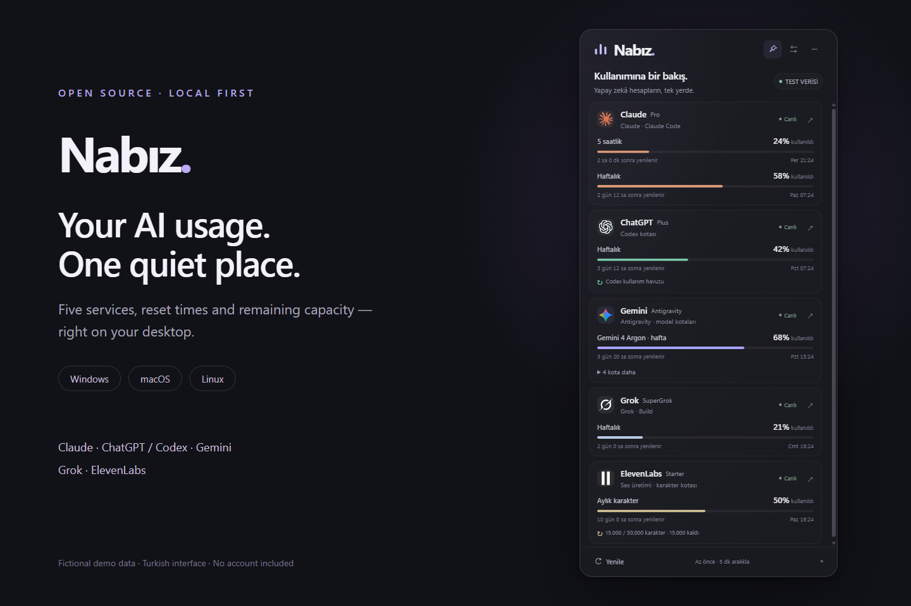
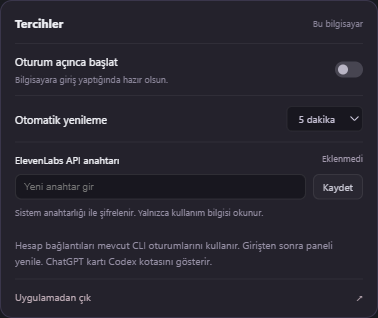

# Nabız

**Your AI usage. One quiet place.**

[Download](https://github.com/TuncayASMA/nabiz/releases/latest) · [Installation & account setup](docs/SETUP.md) · [Türkçe](docs/README.tr.md) · [Privacy](SECURITY.md)



A small, open-source desktop widget for **Claude, ChatGPT / Codex, Gemini,
Grok and ElevenLabs**. See usage percentages and reset times without keeping
five account pages open. Pin it over your work or open it from the system tray.

## Download

Choose your operating system and processor in [Releases](https://github.com/TuncayASMA/nabiz/releases/latest).

| System | Download | Installation |
| --- | --- | --- |
| Windows x64 / ARM64 | `windows-…-setup.exe` | Run the installer; a desktop shortcut is created. |
| Windows portable | `win-….zip` | Extract the entire folder and open `Nabiz.exe`. |
| macOS Apple Silicon | `mac-arm64.dmg` | Drag Nabız into Applications. |
| macOS Intel | `mac-x64.dmg` | Drag Nabız into Applications. |
| Linux x64 / ARM64 | `linux-….AppImage` | Make executable, then launch. A `.tar.gz` fallback is available. |

The first public release is **unsigned** and macOS is **not notarized**. Read the
[OS-specific opening instructions](docs/SETUP.md#install-the-app) before installing.
Checksums are provided with every release. The desktop UI currently uses Turkish;
English and Turkish setup guides are available. Modern Windows, macOS and Linux
are targeted; not every older OS or Linux desktop has been tested.

## What it shows

| Card | Actual source | Scope |
| --- | --- | --- |
| Claude | Claude Code account's usage endpoint | Account usage, five-hour/week windows and extra model pools when reported. |
| ChatGPT | Codex CLI app-server | **Codex limits**, not a universal ChatGPT website message counter. |
| Gemini | Antigravity CLI `/usage` | Separate Argon and shared model pools when available on your account. |
| Grok | Grok CLI account billing | Reported credit usage and reset period; shared pools only when the service says so. |
| ElevenLabs | Official subscription endpoint | Used characters, character limit and renewal date. |

Nabız displays what the provider reports. It does not invent missing limits,
merge unrelated pools, or promise that every plan exposes every metric. It
cannot bypass a limit or grant a subscription. Provider APIs and CLI formats
can change; see [compatibility notes](docs/SETUP.md#troubleshooting).

## Features

- Compact draggable panel, optional always-on-top, tray/menu-bar access.
- Five providers, official brand artwork, reset countdowns and usage bars.
- Refresh every 2, 5, 10 or 15 minutes; rate-limit-aware retries and dated stale data.
- Optional launch at login; per-user configuration.
- Your accounts stay on your computer. No Nabız server, analytics or shared keys.
- OS-encrypted ElevenLabs key storage; insecure Linux fallback is rejected.
- Isolated demo mode and reproducible screenshots containing fictional data.

## Connect your accounts

1. Install Nabız for your OS.
2. Install and log into the provider CLIs you use: Claude Code, Codex, Antigravity and/or Grok.
3. Click **Hesabı bağla** (connect account) for a login command or the setup guide.
4. For ElevenLabs, open **Tercihler** (settings), enter your own API key with User: Read access, and choose **Kaydet** (save).
5. Click **Yenile** (refresh). Unconnected services simply show a connection prompt.

**There are no API keys, accounts or subscriptions included.** You only need to
connect the services you actually use. Full steps, uninstall instructions,
custom CLI paths, security prompts and troubleshooting:
[English](docs/SETUP.md) · [Türkçe](docs/SETUP.tr.md).

<details>
<summary>Settings preview — no key entered</summary>



</details>

## Development

Node.js 22.12+ and a graphical desktop:

```sh
git clone https://github.com/TuncayASMA/nabiz.git
cd nabiz
npm ci
npm run demo
```

`npm start` uses your own local provider sessions. `npm run demo` uses fictional
data and a separate profile. `npm test` runs parsing/platform/security tests;
`npm run test:ui` exercises the actual Electron window with fixtures.
`npm run dist` produces packages for the current OS/CPU.

The release workflow builds and tests on native Windows, macOS and Linux x64
and ARM64 runners. CI does not use real accounts. Windows live-account checks
are separate from cross-platform fixture checks; do not interpret CI as proof
that every provider/account combination works everywhere.

See [CONTRIBUTING](CONTRIBUTING.md), [SECURITY](SECURITY.md) and
[third-party notices](THIRD_PARTY_NOTICES.md). Contributions and compatibility
reports are welcome. Licensed under [MIT](LICENSE).

Nabız is an independent community project, not an official product of any of
the providers. Provider names and logos belong to their respective owners.
